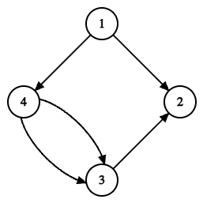

Сдать решение задачи C-Реконструкция города
Ограничение времени:	2 с
Ограничение реального времени:	5 с
Ограничение памяти:	256M
Задача C: Реконструкция города
Условие задачи (pdf)

Саша за свою долгую жизнь смог вырасти из главного в зале до мэра своего родного города. Перед выборами он понял самое главное об урбанистике: в городе не должно быть циклов, ведь в таком случае можно заблудиться.

Поэтому в самом начале своего срока на посту мэра Саша решил выполнить свое предвыборное обещание и убрать циклы в городе. После изучения планировки города он узнал, что транспортная система города состоит из
перекрестков и
двухсторонних дорог, соединяющих некоторые пары перекрестков между собой.

Для достижения своей цели Саша хочет сделать каждую дорогу односторонней. Однако вместо изучения информатики Саша тренировался всю жизнь, поэтому он просит вас помочь и ориентировать дороги таким образом, чтобы в получившейся транспортной системе не было циклов.

Циклом называется набор городов
, где для каждого
дорога ведет из города
в город
, а также
.

Формат входных данных
В первой строке записаны два числа
(
) — количество перекрестков и дорог в городе.

В следующих
строках описаны дороги между перекрестками: каждая дорога задается двумя числами
(
) — номера перекрестков, которые соединяет дорога.

Обратите внимание, что транспортная система не обязана быть связанной, а также в ней могут присутствовать две дороги, которые соединяют одинаковые перекрестки.

Формат результата
Вы должны вывести
строк. В каждой из
строк вы должны вывести два числа
, означающие, что дорога направлена из перекрестка с номером
в перекресток с номером
.

Дороги вы должны выводить в порядке ввода, а также, если существует несколько решений, можете вывести любое из них.

Можно показать, что всегда можно достичь цели.

Примеры
Входные данные
4 5
1 2
2 3
3 4
4 1
4 3
Результат работы
1 2
3 2
4 3
1 4
4 3
Примечания

На этом рисунке изображен способ ориентации ребер, предоставленный в выходных данных.